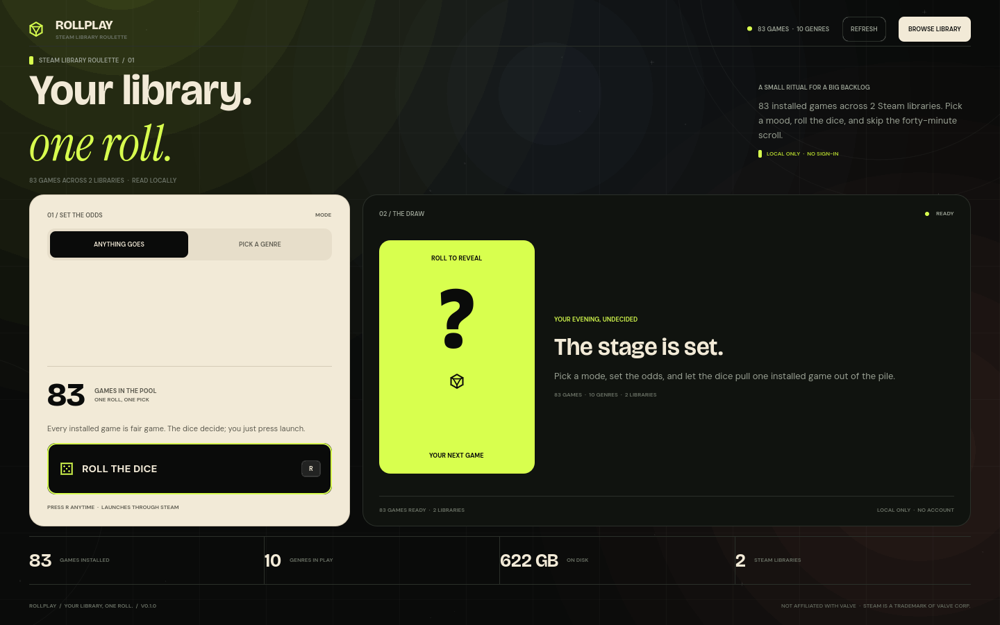
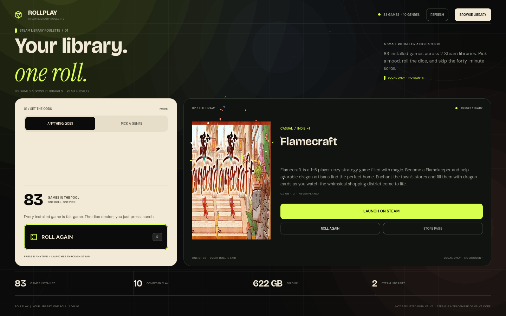

# RollPlay

**Your library. One roll.**

RollPlay is a small desktop ritual for a big backlog. It reads the Steam games
already installed on your PC, picks one at random, and launches it through
Steam. Roll from the whole library, or choose a genre and let the dice narrow
the odds.



## Download

[Download the latest Windows portable build](https://github.com/theclintoris/RollPlay/releases/latest).
Unzip it anywhere and run `RollPlay.exe`. The included `portable.txt` keeps
metadata and cover caches in `RollPlayData` beside the app, so nothing is
installed and no app data is written outside the folder. SHA-256 checksums are
included in the ZIP and alongside it.

## What it does

- Finds Steam through the Windows registry, environment overrides, and the
  extra library folders and drives listed in `libraryfolders.vdf`. Linux and
  macOS detection paths are implemented for future platform builds.
- Reads installed games from `appmanifest_*.acf` files. Fully installed games
  only; tools, runtimes, dedicated servers, demos, and playtests are filtered out.
- Fetches public store metadata and cover art for the games you own, then caches
  it locally so later launches are instant and work offline.
- **Anything goes**: every installed game is in the pool.
- **Pick a genre**: choose one of the genres in your library, then roll a random
  game tagged with it.
- Avoids showing the same winner twice in a row when there is another option.
- Animated cover reel, keyboard shortcut, result details, and a full library
  drawer with search, genre filter, sort, and click-to-launch.
- Launching is handled by Steam's own `steam://rungameid/<app_id>` protocol, so
  Steam handles updates, DRM, and playtime.
- No account, no sign-in, no telemetry, and no developer server. Everything
  except Steam store metadata lives on your machine.



## Requirements

**To play**

- Windows 10/11 (64-bit). A 64-bit Linux build is included, but its runtime is
  still a preview until tested on real Linux hardware.
- Steam installed and at least one fully installed game.
- An internet connection the first time metadata and covers are fetched.

**To build from source**

- [Godot 4.7.2](https://godotengine.org/download/) or newer 4.7.x.
- The Godot export templates for 4.7.2 if you want to create release binaries.
- No third-party Godot plugins or package manager dependencies.

## Run from source

1. Install Godot 4.7.2.
2. Open `project.godot` in the editor, or from a terminal:

   ```powershell
   Godot_v4.7.2-stable_win64.exe --path .
   ```

3. The app scans your Steam libraries on launch. On a first run it will fetch
   store metadata and cover art in the background; the all-random pool is
   available immediately.

Keyboard shortcuts:

| Key | Action |
| --- | --- |
| `R` | Roll / roll again |
| `Esc` | Close the library drawer or alert |
| `Enter` / `Space` | Activate a focused control |

## Build a release

The checked-in `scripts/build-release.ps1` builds both platforms, stages the
license files beside the executables, and writes SHA-256 checksums:

```powershell
powershell -ExecutionPolicy Bypass -File .\scripts\build-release.ps1
```

Pass `-SkipLinux`, `-SkipWindows`, `-Godot <path>`, or `-Version 0.2.0` as
needed. Outputs:

```text
build/windows/RollPlay.exe
build/windows/LICENSES/
build/windows/THIRD_PARTY_NOTICES.txt
build/windows/SHA256SUMS.txt

build/linux/RollPlay.x86_64
build/linux/LICENSES/
build/linux/THIRD_PARTY_NOTICES.txt
build/linux/SHA256SUMS.txt
```

Godot writes a temporary `project.binary` during export. The script redirects
`TEMP`/`TMP` into `.tmp_export` so the export also works on locked-down or
sandboxed machines. On Linux, `chmod +x build/linux/RollPlay.x86_64` before
archiving.

To create the portable Windows ZIP after building:

```powershell
powershell -ExecutionPolicy Bypass -File .\scripts\package-portable.ps1
```

This writes `build/portable/RollPlay-<version>-portable-win64.zip`, its
`.sha256` checksum, a `portable.txt` marker, and a short portable readme.

## Tests

The core logic has headless tests that do not launch a game:

```powershell
# Pick engine
Godot_v4.7.2-stable_win64_console.exe --headless --path . --script tests/test_pick_engine.gd

# Scanner name/path rules
Godot_v4.7.2-stable_win64_console.exe --headless --path . --script tests/test_scanner_rules.gd

# Live scan + metadata + cover probe (uses your local Steam library)
Godot_v4.7.2-stable_win64_console.exe --headless --path . tests/service_probe.tscn

# UI smoke test; writes screenshots into the local data folder
Godot_v4.7.2-stable_win64_console.exe --path . tests/ui_probe.tscn
```

`tests/ui_probe.tscn` is a development harness. It never presses the launch
button, and it is excluded from release exports.

## Where your data lives

RollPlay asks for the normal Godot user-data folder first:

| Platform | Default location |
| --- | --- |
| Windows | `%APPDATA%\RollPlay` |
| Linux | `$XDG_DATA_HOME/RollPlay` or `~/.local/share/RollPlay` |
| macOS | `~/Library/Application Support/RollPlay` |

Inside it:

- `metadata_cache.json` — store names, genres, descriptions, header URLs.
- `covers/` — 2:3 cover art, cached as JPEG.

If a `portable.txt` marker is present next to `RollPlay.exe` (the portable ZIP
includes one), RollPlay uses `RollPlayData` beside the executable instead. If
that folder is not writable, it falls back to `.userdata` beside the project or
executable. You can force a location with the `ROLLPLAY_DATA_DIR` environment
variable. To reset the cache, close the app and delete the folder. Steam files
are never modified.

## How it works

```text
scenes/main.tscn
scripts/main.gd                 UI, roll reel, drawer, launch feedback
scripts/core/
  vdf_parser.gd                 dependency-free KeyValues parser
  app_paths.gd                  writable cache/covers directory
  steam_scanner.gd              Steam roots, libraries, appmanifests
  pick_engine.gd                pool filtering and crypto-random rolls
  library_service.gd            scan, enrich, snapshot, launch
  cover_cache.gd                cover queue, disk cache, textures
scripts/ui/                     design system and custom-drawn widgets
tests/                          headless probes and test suites
steam/                          SteamPipe templates (placeholders)
```

A scan does not need Steam to be running. Launching does: Steam must be running
or able to start from its protocol handler.

## Troubleshooting

**"No Steam library found"**

- Confirm Steam can see the games in its own library.
- Start Steam once so it writes `libraryfolders.vdf`.
- If Steam is installed in a non-standard place, set `STEAM_PATH` to the Steam
  root (the folder containing `steamapps`) and restart RollPlay.
- On Linux, Flatpak and Snap Steam paths are checked. For a custom prefix, set
  `STEAM_PATH`.
- On a secondary drive, the library must be registered in Steam's storage
  settings; RollPlay reads the same `libraryfolders.vdf` Steam does.

**Games have no genres, or genre chips are still filling in**

RollPlay is fetching public Steam Store metadata. This can take a minute on a
large library. All-random works immediately. Use **Refresh** after the network
comes back. If a game was removed from the Steam Store, it stays in the
all-random pool but may not have genre metadata.

**The game count is lower than Steam's**

Demos, playtests, dedicated servers, Proton/runtime packages, soundtracks,
artbooks, and known tools are deliberately excluded. RollPlay is a game
roulette, not an installer inventory.

**Launch does nothing**

- Make sure Steam is installed and running.
- Test that `steam://rungameid/2379780` opens Balatro (or any owned game) from
  Windows Run. If that does not work, repair Steam's URL association.
- A game that needs an external launcher may open that launcher instead of going
  straight into the game. RollPlay still counts that as a successful handoff.

**The app cannot write its cache**

Set `ROLLPLAY_DATA_DIR` to a writable folder. RollPlay already falls back to a
local `.userdata` directory if the normal user folder is blocked.

## Release status

This repository is a commercial release foundation, not a published store
build. The app is functional and tested against an 83-game, two-library Steam
collection on Windows. Before selling it:

- complete the checklist in [STEAM_RELEASE.md](STEAM_RELEASE.md);
- set your real Steamworks app ID in `project.godot`;
- replace the support/privacy placeholders;
- test from a clean Windows user account and on Linux;
- add code signing certificates and store art.

## Privacy and licenses

RollPlay reads your local Steam library and makes anonymous public requests to
Valve's Steam Store API and CDN for game metadata and cover images. It does not
require or transmit a Steam account, and it has no analytics or developer
backend. See [docs/PRIVACY.md](docs/PRIVACY.md) for the full description.

Bundled third-party components and licenses are listed in
[THIRD_PARTY_NOTICES.txt](THIRD_PARTY_NOTICES.txt) and the `licenses/` folder.
Godot Engine is MIT-licensed; the bundled fonts are SIL OFL 1.1; the CA bundle
is MPL 2.0. Steam and the Steam logo are trademarks of Valve Corporation.
RollPlay is not affiliated with or endorsed by Valve.

## Credits

Design and code: RollPlay. Built with Godot Engine, Bricolage Grotesque, DM
Sans, and Instrument Serif. Thanks to Valve for the public Steam Store API and
cover CDN that make a library shelf possible.
